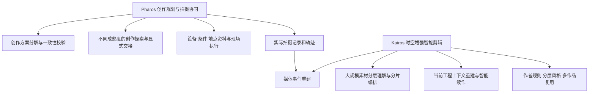

# Pharos 与 Kairos 创作系统专利布局

## 产品核心与布局判断

**Pharos：AI 驱动的影像创作规划与拍摄协同系统。** 从作者意图出发，结合拍摄条件、设备和研究语境，组织创作方案；再将确认方案落实为拍摄事件、机位及执行任务，记录实际发生，为后续创作与剪辑提供依据。旅行是现有实施场景；同一机制可服务纪录片和按场景组织的电影拍摄。

**Kairos：以多模态理解和项目时空信息为基础的大规模素材智能剪辑助手。** 从真实视听素材中取得可引用片段，结合时间、轨迹和拍摄事实建立事件组织；AI 据此理解项目、按作者规则组织叙事、选择素材并建立专业剪辑工程，接续人工编辑继续创作。

两者共同形成：**创作意图 → 拍摄方案 → 实际拍摄事实 → 素材理解与事件组织 → 作品编排 → 可继续编辑的工程。**

**当前建议按6个申请方向准备：2件总体主案＋4件核心子案。** 两件总体主案已重写；四个子案已写出技术问题、独立权利要求骨架及与主案的分工。原“四件”不再作为完整布局。

| 编号 | 申请方向 | 核心保护关系 | 当前文本 |
|---|---|---|---|
| P0 | 人工智能驱动的影像创作规划与拍摄协同 | 作者意图经 AI 转为资源化拍摄事件，经审查进入现场执行，再形成可供后期使用的实际拍摄上下文 | [总体主案：12项权利要求及说明书](/Users/dtysky/Projects/dtysky/Pothos/research/20261030-pharos-kairos-patent-drafts/05-pharos-creative-system.md) |
| P1 | 面向拍摄资源的创作方案分解与一致性校验 | 确认创作文本 → AI 多粒度拍摄任务 → 资源检查与语义覆盖审查 → 可执行计划 | [核心子案骨架](/Users/dtysky/Projects/dtysky/Pothos/research/20261030-pharos-kairos-patent-drafts/07-core-mechanisms.md) |
| K0 | 多模态素材与时空事件驱动的智能剪辑 | 大规模素材理解 → 实际时空事件 → 叙事框架与选材 → 原生工程及人工编辑后的继续创作 | [总体主案：13项权利要求及说明书](/Users/dtysky/Projects/dtysky/Pothos/research/20261030-pharos-kairos-patent-drafts/06-kairos-contextual-editing.md) |
| K1 | 融合拍摄记录与轨迹的媒体事件重建 | 片段源范围转为实际时间，关联真实执行窗口与轨迹，再经受约束的 AI 语义归并形成项目事件 | [核心子案骨架](/Users/dtysky/Projects/dtysky/Pothos/research/20261030-pharos-kairos-patent-drafts/07-core-mechanisms.md) |
| K2 | 大规模素材的分层理解与分片剪辑编排 | 可复用报告和片段索引、全局框架、有界任务上下文及可回溯的片段选择共同支持长周期创作 | [核心子案骨架](/Users/dtysky/Projects/dtysky/Pothos/research/20261030-pharos-kairos-patent-drafts/07-core-mechanisms.md) |
| K3 | 基于当前剪辑工程的上下文重建与智能续作 | 人工编辑改变工程后，以当前源范围重建事实和时序，再由 AI 完成旁白、字幕或局部创作 | [核心子案骨架](/Users/dtysky/Projects/dtysky/Pothos/research/20261030-pharos-kairos-patent-drafts/07-core-mechanisms.md)，承接原旁白字幕稿 |

## 为什么主案必须这样写

P0 的基本单位是创作内容对应的拍摄事件。事件可以包含多个机位和设备，空间条件与资源会影响任务如何生成，现场事实又决定后期实际拥有的素材。若只保护“候选改期后不丢记录”，就丢掉了 AI 把作者目标转成拍摄生产的主体机制。

K0 的基本单位是可追溯到源媒体范围的素材片段。其上分别建立画面与声音理解、真实时空事件和作品叙事。系统先知道素材是什么、何时何地发生、属于什么实际过程，再决定某个作品怎样使用它。若从执行计划或字幕生成开始写，素材理解与项目事件层就被错误地当成了现成输入。

“海量”落实为处理结构：分阶段分析、窗口细扫、可复用事实、片段索引、宏观框架、有界上下文和结果合并。已有项目索引达到2,253个媒体资产、6,626个候选片段，具体统计口径和来源列在 K0 中。

## 从总体向下挖掘

P1 可以只接收已有创作文本和资源注册表，独立输出拍摄计划；K1 可以只接收素材片段与拍摄时空资料，独立输出事件组织；K2 可以消费已确认项目事实，专门处理大规模创作任务；K3 可以直接接手已有编辑工程。这四个子案各自具有完整输入、处理和输出，不要求实施整个总体系统。

Atlas 的不同成熟度规划、Argo 资源约束、作品与地点资料进入 P0 的保护层次。作者规则、分层风格及多作品复用进入 K0/K2。Pharos 与 Kairos 的衔接重点落在 K1 的实际拍摄语义转换，不将普通数据传递另凑一案。

## 原四份稿件重新归位

| 原稿 | 当前定位 |
|---|---|
| [01：计划与执行协同](/Users/dtysky/Projects/dtysky/Pothos/research/20261030-pharos-kairos-patent-drafts/01-pharos-collaboration.md) | P0 下的动态执行机制素材，不再代表 Pharos 总体主案 |
| [02：地点工作台](/Users/dtysky/Projects/dtysky/Pothos/research/20261030-pharos-kairos-patent-drafts/02-pharos-place-workspace.md) | 现场交互分支，优先级低于创作生成与素材理解主线 |
| [03：能力计划](/Users/dtysky/Projects/dtysky/Pothos/research/20261030-pharos-kairos-patent-drafts/03-kairos-edit-flow.md) | K0/K2 下的创作执行组织，保留规则与能力合同内容 |
| [04：精剪后旁白字幕](/Users/dtysky/Projects/dtysky/Pothos/research/20261030-pharos-kairos-patent-drafts/04-kairos-timeline-narration.md) | K3 的具体实施方式，AI 输入须包含当前工程与回查的素材事实 |

## 公开能力对照与撰写重点

本轮对照同时覆盖产品、论文和专利。产品对照用于识别能力重合；专利公开内容用于继续核对具体技术组合。

| 公开来源 | 已公开的相关能力 | 本项目重点比较的关系 |
|---|---|---|
| [US20220237368A1](https://patents.google.com/patent/US20220237368A1/en) | 从剧本场景生成镜头清单与分镜 | P0/P1 的实际资源引用、上下层语义审查、终端执行事实与后期交接 |
| [US20260194361A1](https://patents.google.com/patent/US20260194361A1/en) | 模型生成及迭代行程 | Pharos 的创作拍摄事件及多设备条目生成、执行记录结构 |
| [Premiere Media Intelligence](https://helpx.adobe.com/premiere/desktop/organize-media/file-organization/search-for-media-using-ai-powered-media-intelligence.html) | 视觉、语音及日期地点等元数据检索 | Kairos 如何从视听片段与外部实际时空事实建立可编排事件 |
| [Premiere AI Assistant](https://helpx.adobe.com/premiere/desktop/premiere-ai-assistant/assistant-faq.html) | 对话式多步骤编辑、整理素材和生成初剪 | 项目拍摄事实与作者规则如何参与事件组织、选材和工程续作；该页2026-06-18版本称脚本与生产笔记驱动的上下文仍在探索 |
| [TwelveLabs 检索文档](https://docs.twelvelabs.io/docs/guides/search/search-with-text-and-image-queries) | 文本、图像及组合查询定位视频片段 | 从搜索结果推进到事件理解、完整作品组织及实际工程的连续处理 |
| [WO2026089657A1](https://patents.google.com/patent/WO2026089657A1/en) | 多阶段长视频理解，编码帧间时空及多模态信息 | K0/K2 的多资产项目、真实地理轨迹与拍摄记录、可复用片段索引和分片创作 |
| [EP3338058B1](https://patents.google.com/patent/EP3338058B1/en) | 地图及轨迹关联的视频片段选择与展示 | K1 的实际事件归属、受约束语义归并及对后续创作的输入 |
| [US20260253414A1 公开文本转载](https://patents.justia.com/patent/20260253414) | 说明书涉及时间地点、主题和事件信息参与媒体分组及编辑 | 列为 K0/K1 的重点近似文献；进一步比较实际拍摄窗口、轨迹关联、独立事实层及工程续作的具体组合 |
| [US20260094440A1](https://patents.google.com/patent/US20260094440A1/en)、[EditDuet](https://arxiv.org/abs/2509.10761) | 自然语言时间线处理、智能体调用编辑工具 | 保留工程操作之前的素材理解与时空事件链，避免把一般智能体剪辑当作全部发明点 |

据此，竞争定位围绕整条创作链和深度组织能力展开。本文不作市场性能排名；当前有实现和数据支撑的重点是素材规模、时空事件组织、规则驱动创作和真实工程协作。

## 文本规范

本轮为发明交底与权利要求草案，模型输入、输出及与场景的关联写入各案实施方式。规范依据采用[现行《专利法》](https://www.cnipa.gov.cn/art/2020/11/23/art_97_155167.html)及[2025年审查指南修改解读](https://www.cnipa.gov.cn/art/2025/12/4/art_66_202935.html)。内部来源路径及检索表保留为撰写依据。
