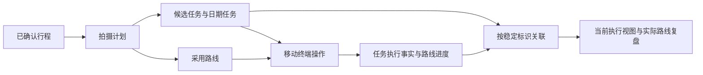
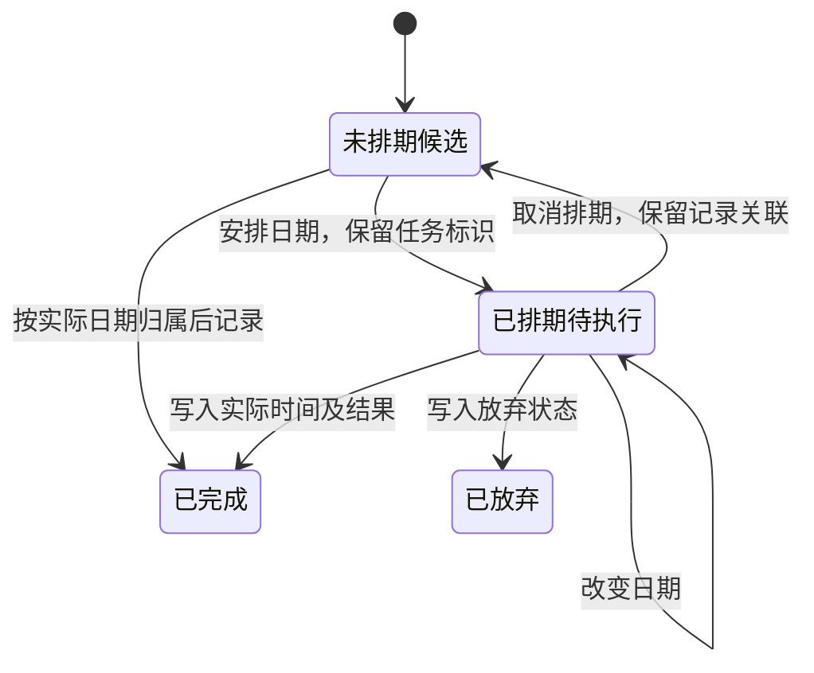

# 一种实地拍摄计划与执行协同方法及系统

当前 Pharos 总体主案见[创作规划与拍摄协同](/Users/dtysky/Projects/dtysky/Pothos/research/20261030-pharos-kairos-patent-drafts/05-pharos-creative-system.md)。本稿保留为下层执行机制。

## 说明书摘要

本发明涉及移动终端中的实地拍摄计划与执行协同。系统以稳定任务标识关联拍摄任务和执行记录，分别维护未排期候选、按绝对日期组织的执行安排、采用路线及路线执行进度。待执行任务可在候选集合与日期集合之间迁移，并保留任务身份及记录关联；直接执行候选任务时，先按实际执行日期建立归属再写入执行事实。路线调整作用于尚未处理的位置，已处理位置及其标识保持；现场新增的计划外拍摄单独记录。系统按关联后的当前计划和实际记录生成执行视图及复盘数据，使行程变化过程中拍摄对象、现场记录与后续素材组织保持连续。

## 权利要求书

1. 一种实地拍摄计划与执行协同方法，由计算机系统执行，其特征在于，包括：

获取拍摄计划，所述拍摄计划包含具有稳定任务标识的拍摄任务、未排期候选集合、按绝对日期组织的已排期集合，以及具有稳定地点标识的路线地点序列；

建立与所述拍摄计划分别维护的执行记录，所述执行记录包括通过所述任务标识关联的任务执行状态，以及通过所述地点标识关联的路线地点处理状态；

响应于对处于待执行状态的拍摄任务的排期操作，将该拍摄任务在所述未排期候选集合与所述已排期集合之间迁移，或者在不同绝对日期的已排期集合之间迁移，保持其任务标识及执行记录关联不变；

响应于对未排期候选集合中的拍摄任务的实际执行记录操作，按照实际执行日期建立或定位日期集合，将该拍摄任务移入所述日期集合，再将实际执行时间及拍摄结果写入与其任务标识关联的执行记录；

响应于路线地点序列的重排操作，根据所述路线地点处理状态确定可调整位置与已处理位置，仅重排所述可调整位置上的地点，保持所述已处理位置上的地点标识与处理状态；

根据所述任务标识、地点标识和绝对日期，将当前拍摄计划与执行记录关联，输出包含当前待执行拍摄任务和已发生拍摄事实的移动执行视图。

2. 根据权利要求1所述的方法，其特征在于，拍摄任务包括事件型任务和连续行程型任务；事件型任务包含同一拍摄事件下的多个拍摄条目，各拍摄条目记录拍摄类型及设备；连续行程型任务包含行程起终点、多设备视角及位于连续行程中的台词点，执行记录以相同的任务标识分别关联两种类型的任务。

3. 根据权利要求1所述的方法，其特征在于，所述拍摄计划根据经过用户确认的行程文档生成，生成结果包括结构化拍摄任务及对应的人类可读审阅内容，并在接收对该生成结果的确认后发布至移动终端；后续修改以修订版本标识进行区分。

4. 根据权利要求1所述的方法，其特征在于，执行记录区分待执行、符合预期完成、偏离预期完成及放弃状态；对不对应既有拍摄任务的实际拍摄，建立计划外执行记录，所述计划外执行记录与提前新增的拍摄任务分别保存。

5. 根据权利要求1所述的方法，其特征在于，删除尚未处理且关联有拍摄任务的路线地点时，在同一次计划变更中删除该地点并解除相应拍摄任务的地点关联，保留所述拍摄任务及其执行记录，并将所述拍摄任务加入未归属地点的显示集合。

6. 根据权利要求1所述的方法，其特征在于，分别从已排期集合和未排期候选集合中提取所引用的设备信息，生成设备校时事项与去重器材事项，并与显式指定的准备事项合并；当引用的设备或准备事项发生变化时更新事项集合，以事项标识保留相应的本地完成状态。

7. 根据权利要求1所述的方法，其特征在于，利用实际执行时间关联定位轨迹中的位置，生成包含计划内和计划外拍摄事实的实际路线视图；对历史补录操作，通过具有导入标识的追加数据交由移动终端合并为执行记录，已成功应用的相同导入数据不重复加入。

8. 一种实地拍摄计划与执行协同系统，包括处理器和存储器，所述存储器存储计算机程序，其特征在于，所述计算机程序被所述处理器执行时，使系统执行权利要求1至7中任一项所述的方法。

9. 一种计算机可读存储介质，其上存储有计算机程序，其特征在于，所述程序被处理器执行时实现权利要求1至7中任一项所述的方法。

10. 一种计算机程序产品，包括计算机程序，其特征在于，所述程序被处理器执行时实现权利要求1至7中任一项所述的方法。

## 技术领域

本发明涉及移动计算、拍摄任务处理及地理信息关联，尤其涉及能够在候选拍摄安排、执行排期及实际记录之间保持对象关联的实地创作协同方法。

## 背景技术

动态行程系统已经能够根据时间、路线和约束调整事件。地理影像管理系统也已公开将拍摄计划标识、路线标识和实际影像关联的方案。针对相关公开内容，本案关注的具体问题是：拍摄任务可长期处于未排期候选状态，现场可以直接执行候选、改变后续路线和新增未预先计划的拍摄；在这些操作共同发生时，需要防止迁移造成重复任务、执行记录失去日期归属，或者路线重排改变已处理位置。

对应的检索入口为 WO2017040567A1、WO2008072427A1；具体比较见本文件末尾的撰写依据。

## 发明内容

本发明采用任务身份、执行排期及执行事实分别表达的方式。排期变化改变任务所属集合，任务标识继续作为执行记录的关联依据。候选直接完成时先建立实际日期归属，使已完成事实不会悬挂在没有日期的候选集合中。采用路线的结构与其进度分开维护，重排仅作用于待处理槽位。

上述处理共同维持三个约束：同一任务不因重新排期而被复制；实际完成记录能够通过原任务标识定位；已处理路线位置不因未来路线调整而变化。计划外拍摄作为实际记录进入复盘，而不倒造拍摄前已经存在的任务。

## 附图说明

图1表示规划、移动执行及复盘的数据关系。图2表示候选任务的排期及执行转换。图3表示待处理路线槽位的重排。

图1：

图2：

图3的路线示意为：A（已完成）、B（待处理）、C（已跳过）、D（待处理），交换待处理项后形成 A、D、C、B；A、C 的位置与身份保持不变。

## 具体实施方式

### 1. 数据对象

计划对象保存任务集合与路线结构。任务对象包含 taskId、kind、captureItems，以及可选 placeId。任务在候选集合或某个 date 对应的集合中出现。执行对象按 taskId 保存 status、actualStart、actualEnd 和 actualCaptures。路线对象按 placeId 保存顺序、地理坐标和预计到离时间，路线进度对象另存各地点状态与当前目标。

任务标识与集合位置、日期编号和显示名称解耦。日期列表新增或重新排序时，以日期值确定归属，不以旧序号重新解释记录含义。

### 2. 任务迁移

接收排期操作后，读取当前任务记录并验证其为待执行状态。若目的日期集合不存在，则建立该集合；从原集合移除同一任务对象并加入目的集合；生成一次计划变更。执行记录继续使用原 taskId。

对候选任务直接记录拍摄时，使用用户确认的实际日期建立归属。补录历史拍摄时，不将保存操作发生时的当前位置自动用作历史实际位置；实际位置可以缺省，复盘时结合实际时间和已有轨迹处理。

### 3. 路线调整

根据地点处理状态建立已处理位置集合和待处理位置集合。用户拖动后，只把新的待处理地点顺序写回待处理位置。删除未来地点时同步解除相关任务的地点引用，任务及记录继续存在。删除当前目标时选择剩余待处理地点作为新目标。

路线完成或跳过操作更新进度对象；路线结构编辑更新计划对象。二者通过稳定地点标识关联。

### 4. 现场记录与复盘

移动终端先完成本地状态保存和视图更新，再进行远端同步。现场新增的未来拍摄任务进入计划；现场已发生而此前没有任务的拍摄进入计划外记录。复盘按实际时间关联轨迹，叠加已完成拍摄点和计划外拍摄点。

对于前期长期规划，可由长期行旅档案生成显式交接快照，再形成上述计划。该交接是规划来源的实施例，不是权利要求1的必经步骤。

### 5. 准备事项与历史补录

遍历候选集合及各日期集合的拍摄任务，提取其设备引用，按设备标识合并重复项；为参与拍摄的设备建立校时事项，将器材事项与用户指定的准备事项合并。各事项采用稳定标识，本地完成状态按该标识另存。重新派生事项集合时，保留仍然存在的事项所对应的完成状态。

历史补录数据包含导入标识、目标任务标识或计划外拍摄条目，以及实际时间与拍摄结果。移动终端检查导入标识是否已经应用；未应用时合并记录并保存应用标记，再次收到同一导入数据时不重复加入。补录记录继续通过任务标识参与实际时间和轨迹的关联。

## 撰写依据与取舍

本案独立保护的组合为：稳定任务身份、候选与日期集合迁移、候选直接完成时先建立实际日期归属，以及保留已处理槽位的路线调整。长期图志、器材准备、离线同步和研究资料作为附加实施方式展开。

- [任务集合迁移实现](/Users/dtysky/Projects/dtysky/Pharos/pyxis/app/src/main/java/com/dtysky/pyxis/data/FreeformTripManagement.kt:345)
- [路线删除与重排实现](/Users/dtysky/Projects/dtysky/Pharos/pyxis/app/src/main/java/com/dtysky/pyxis/data/RouteBookmarkManagement.kt:260)
- [协议中的对象及归属](/Users/dtysky/Projects/dtysky/Pharos/designs/protocol.md:595)
- [行前准备派生](/Users/dtysky/Projects/dtysky/Pharos/designs/pyxis-architecture.md:408)

WO2008072427A1 的权利要求1已关联路线、拍摄计划与实际影像，所以“计划关联实际拍摄”不单独作为本案区别点。WO2017040567A1 已公开路线与事件调整，本案采用上述任务生命周期与历史位置约束的联合限定。[地理影像管理公开文本](https://patents.google.com/patent/WO2008072427A1/en)、[动态行程公开文本](https://patents.google.com/patent/WO2017040567A1/en)。
