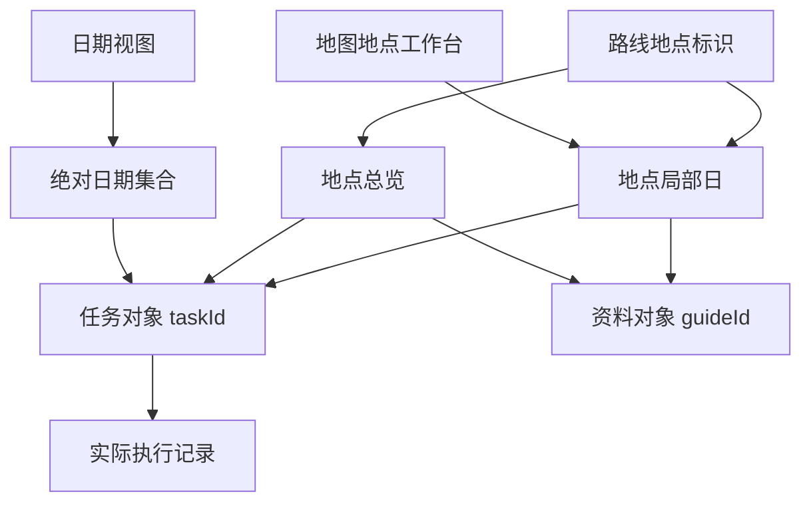
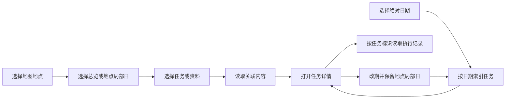

# 一种基于地点局部日的现场任务与资料组织方法

## 说明书摘要

本发明公开一种基于地点局部日的现场任务与资料组织方法。针对一个路线地点，分别记录地点标识、地点内局部日标识及任务的绝对排期日期；任务执行记录通过任务标识关联实际发生时间。资料条目通过地点及局部日关联到同一工作上下文。移动终端响应地图地点选择，在地点工作台中按局部日聚合任务与资料，并通过独立日期视图呈现执行安排。任务改期、移回候选或写入执行记录时，保留其地点及局部日关联。由此支持在实际到访日期变化或尚未确定时，继续访问当地拍摄安排及资料。

## 权利要求书

1. 一种基于地点局部日的现场任务与资料组织方法，应用于具有显示界面的计算设备，其特征在于，包括：

建立路线地点对象，各路线地点对象具有地点标识；建立具有任务标识的拍摄任务，并为拍摄任务分别保存地点关联、可选的地点局部日关联和可选的绝对日期排期，所述地点局部日用于表示同一地点内的任务分组，与绝对日期分别维护；

建立资料对象，通过包含地点标识及可选地点局部日标识的关联项，使资料对象与所述拍摄任务具有共同的地点工作上下文；

响应于地图中的地点选择操作，按照选中地点标识取得拍摄任务和资料对象，在地点工作台中提供地点总览、地点局部日选择以及任务与资料的内容类型选择，并根据所选地点局部日及内容类型输出对应内容；

响应于拍摄任务的改期操作或在未排期候选与已排期任务之间的迁移操作，更新其绝对日期排期并保留任务标识、地点关联及地点局部日关联；

通过独立的日期视图输出按绝对日期组织的拍摄任务，并通过任务标识关联实际执行记录，使地点工作台和日期视图访问同一拍摄任务。

2. 根据权利要求1所述的方法，其特征在于，在拍摄任务或资料对象具有有效地点关联但未具有地点局部日关联时，将其纳入地点总览；在地点关联缺失或失效时，将其纳入全程未归属集合。

3. 根据权利要求1所述的方法，其特征在于，在路线地点的预计到达日期变化时，不根据该日期变化自动改写地点局部日标识；对于依据日期推导的局部日关联，先输出关联建议，并仅在接收到显式确认后保存该关联。

4. 根据权利要求1所述的方法，其特征在于，资料对象保存在独立于拍摄计划的资料包中，所述资料包具有独立修订标识，资料对象还通过作品标识形成作品索引；更新资料包不改变拍摄任务的排期及执行状态。

5. 根据权利要求1所述的方法，其特征在于，所述地点工作台以覆盖地图的面板显示；从工作台进入拍摄任务或资料详情时保留地图宿主及地点选择、局部日选择、内容类型选择和地图变换状态，返回时恢复至所述上下文。

6. 根据权利要求1所述的方法，其特征在于，当修改仅涉及任务与地点的关联、地点局部日关联或者执行状态时，保留路线几何标识，不因该修改重新获取路线几何或地图底图。

7. 根据权利要求1所述的方法，其特征在于，预计旅行窗口已确定而尚未建立绝对日期任务集合时，仍根据路线地点及地点局部日关联提供任务与资料访问；进入地点工作台不自动创建绝对日期任务集合。

8. 一种现场任务与资料组织系统，包括处理器、存储器和显示组件，所述存储器存储有程序，其特征在于，所述程序被执行时使系统执行权利要求1至7中任一项所述的方法。

9. 一种计算机可读存储介质，其上存储有程序，其特征在于，所述程序被处理器执行时实现权利要求1至7中任一项所述的方法。

10. 一种计算机程序产品，包括程序，其特征在于，所述程序被处理器执行时实现权利要求1至7中任一项所述的方法。

## 技术领域

本发明涉及移动端数据组织及地图交互，尤其涉及地点上下文、相对任务分组与绝对日期分别维护的现场创作工作台。

## 背景技术

地点任务系统已能够基于位置和时间推荐、合并或安排任务。实地创作中，同一地点的多日拍摄内容与现场资料可能在绝对日期确定前形成；到访时间改变时，单纯按日历日期组织内容会使用户需要重新寻找或归类当地任务及资料。

本发明解决任务排期改变时，地点内容组织与实际日期处理之间的关联保持问题，并使不同入口继续访问同一任务对象。

## 发明内容

系统为任务维护三个分别表达的维度：地点身份、地点内部局部日和绝对日期。其中局部日是地点上下文中的分组标签，不由到访日期实时计算。任务与资料通过地点和局部日建立共同的聚合键，日历视图则根据绝对日期索引同一任务。

上述结构使未排期内容可以提前进入现场工作台；后续排期变化不需要重建地点资料关联；执行记录通过任务标识保持可访问。地图几何与任务归属分别管理时，还可避免内容归属操作触发地图资源更新。

## 附图说明

图1表示任务、资料与执行记录的索引关系。图2表示地点选择、内容筛选和日期视图的访问流程。

图2：

## 具体实施方式

### 1. 对象与聚合

路线地点对象含 placeId。任务对象含 taskId、placeId、localDay；其绝对排期由所属日期集合表示。资料对象含 guideId，并可包含多个 {placeId, localDay} 关联项。

读取任务时，同时遍历已排期和未排期集合，按 placeId 建立地点索引；有 localDay 的对象再形成局部日子集合。资料按相同聚合键形成对应集合。没有 localDay 的内容只参加地点总览，悬空地点引用进入未归属视图。

### 2. 日期变化示例

任务 T1、T2 属于地点 A 的局部日2，资料 G1 关联 A 的局部日2。T1 已安排至11月3日，T2 尚未排期。将 T1 改期至11月5日时，仅改变日期归属；地图上选择 A 的局部日2，仍取得 T1、T2 和 G1。

若地点 A 的预计到达日改变，系统继续保留该局部日分组；用户可以显式修改任务的局部日。实际执行时，记录按 taskId 保存实际时间，日期视图与地点工作台引用同一记录。

### 3. 地点工作台

地图是持久宿主。选择地点后展示覆盖面板，先按总览或局部日筛选，再切换任务或资料。进入任务详情后返回，继续使用原地点、局部日和地图状态。

当路线几何没有变化，仅执行关联编辑或状态更新时，复用已有路线图和底图。作品索引及地点索引共同访问独立资料包，资料包更新不会修改任务执行状态。

资料包包含修订标识、资料条目以及作品索引。收到新修订后替换本地资料及其索引；地点工作台按既有地点与局部日重新查询资料，任务集合与执行记录分别保存，不随资料包替换。若需要根据预计到达日期生成局部日关联，先形成可审阅的关联建议，确认后才写入任务或资料关联项。

## 撰写依据与取舍

本案独立于 P-A：输入可以直接是一组地点、任务和资料，不要求经过自动规划、路线历史重排或实际路线复盘。区别组合是三种组织维度的分离、任务与资料共用地点局部日关联，以及地点/日期双入口访问同一任务。

- [任务地点与局部日字段](/Users/dtysky/Projects/dtysky/Pharos/pyxis/protocol/src/main/kotlin/com/dtysky/pharos/protocol/FreeformOptions.kt:143)
- [地点聚合实现](/Users/dtysky/Projects/dtysky/Pharos/pyxis/app/src/main/java/com/dtysky/pyxis/data/RouteShotGrouping.kt:38)
- [地点工作台设计](/Users/dtysky/Projects/dtysky/Pharos/designs/pyxis-architecture.md:952)
- [资料包及索引](/Users/dtysky/Projects/dtysky/Pharos/designs/overview.md:189)

US11741406B2 的权利要求1以地点任务的先后耗时估计和合并建议为中心。本案权利要求1围绕局部日关联与排期变化后的双视图访问组织，不把一般的位置任务推荐作为区别点。[地点任务公开文本](https://patents.google.com/patent/US11741406B2/en)。
