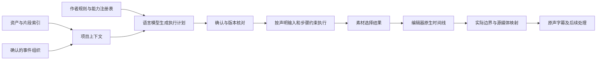
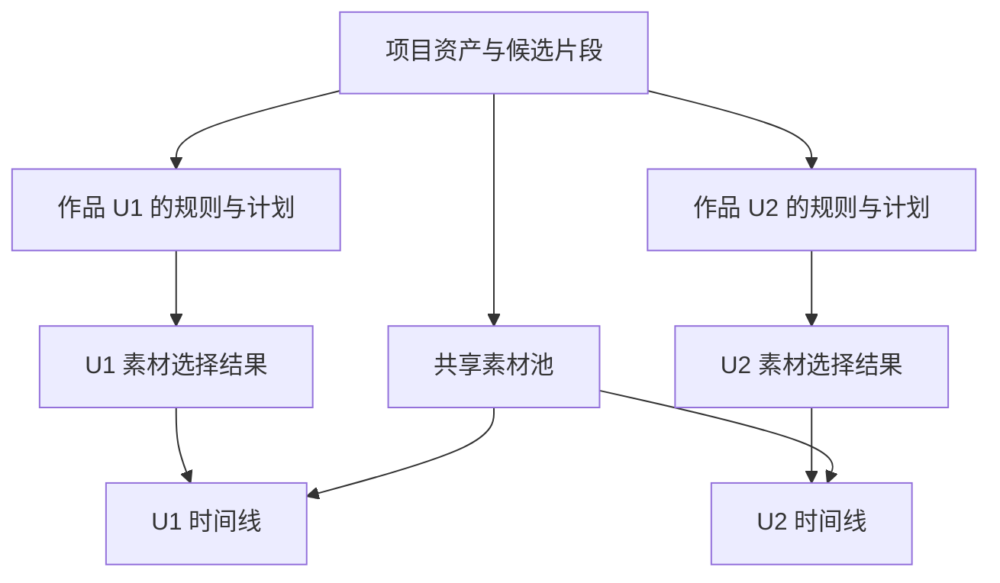

# 一种基于项目事实与能力计划的视频编辑协同方法

当前 Kairos 总体主案见[多模态素材与时空事件驱动的智能剪辑](/Users/dtysky/Projects/dtysky/Pothos/research/20261030-pharos-kairos-patent-drafts/06-kairos-contextual-editing.md)。本稿保留为下层创作执行机制。

## 说明书摘要

本发明公开一种基于项目事实与能力计划的视频编辑协同方法。系统将源媒体分析事实、候选片段和经确认的事件组织保存为项目事实，针对作品单元取得创作规则与能力注册信息，生成具有能力标识、输入引用、输出引用、审查条件及执行约束的计划。经确认且规则版本与声明输入状态匹配后，依据当前步骤约束生成素材选择结果，再由编辑器接口建立可编辑时间线。系统读取编辑器返回的实际片段边界，形成与源媒体范围对应的时间线记录及原声字幕。由此使自然语言创作规则、机器执行依据与实际编辑工程之间形成可追溯的协同关系。

## 权利要求书

1. 一种基于项目事实与能力计划的视频编辑协同方法，由计算机系统执行，其特征在于，包括：

为源媒体建立资产索引与候选片段索引，所述候选片段索引包含候选片段标识、源媒体标识、源时间范围及分析内容，并形成经用户确认的事件组织数据；

针对作品单元获取创作规则及能力注册信息，所述能力注册信息记载能力标识及能力所对应的输入、输出和执行类型；

利用语言模型处理所述创作规则、能力注册信息和项目上下文，生成执行计划，所述执行计划中的步骤分别包含能力标识、输入引用、输出引用、审查条件及从创作规则提取的步骤约束，并保存所采用创作规则的版本信息；

在接收到执行计划确认后，对将执行的步骤核对创作规则版本以及该步骤声明输入的可用状态，并将该步骤约束及声明输入提供给对应能力执行；

通过素材选择能力生成包含候选片段标识及片段处理参数的结构化选择结果，由时间线能力根据所述选择结果取得对应源媒体范围，通过编辑器接口建立可编辑时间线；

读取编辑器返回的实际片段时间边界，按照所述实际片段时间边界形成与源媒体范围对应的时间线记录，并依据已采用且保留原声的候选片段生成与该时间线记录对应的原声字幕。

2. 根据权利要求1所述的方法，其特征在于，源媒体分析事实、候选片段索引和事件组织数据分别存储；候选片段由源媒体分析事实生成，事件组织数据关联候选片段标识并记录事件、路线或缺口；叙事编排结果作为作品单元的产物保存。

3. 根据权利要求1所述的方法，其特征在于，各步骤的输入引用分别限定所需项目事实的类型和范围；将步骤约束随对应输入构成执行上下文，执行所述步骤时以该上下文中的创作约束指导能力调用和产物生成。

4. 根据权利要求1所述的方法，其特征在于，对发生创作规则内容变化、作品单元规则选择变化或所采用风格档案变化的执行计划设置过期状态，在计划更新并获得确认前阻止对应步骤继续采用该计划。

5. 根据权利要求1所述的方法，其特征在于，风格档案包含语言表达、影像审美及剪辑技法的分层内容，执行计划记录启用的风格层及其使用方式；能力执行时仅向相应步骤提供被启用的风格层，风格观察转为强制约束时记录于创作规则或经确认计划。

6. 根据权利要求1所述的方法，其特征在于，多个作品单元共用项目级资产索引、候选片段索引、事件组织数据以及编辑器素材池，分别保存各自的创作规则选择、执行计划和素材选择结果，并分别建立时间线。

7. 根据权利要求1所述的方法，其特征在于，在用户对所述可编辑时间线进行人工编辑后，读取当前时间线的片段顺序、源媒体范围及字幕，将读取结果作为后续步骤的声明输入，使后续步骤依据实际编辑结果继续处理。

8. 一种视频编辑协同系统，包括处理器及存储器，所述存储器存储有计算机程序，其特征在于，所述程序被处理器执行时，使系统执行权利要求1至7中任一项所述的方法。

9. 一种计算机可读存储介质，其上存储有程序，其特征在于，所述程序被处理器执行时实现权利要求1至7中任一项所述的方法。

10. 一种计算机程序产品，包括程序，其特征在于，所述程序被处理器执行时实现权利要求1至7中任一项所述的方法。

## 技术领域

本发明涉及媒体处理、语言模型辅助任务执行和非线性视频编辑，尤其涉及将创作者规则转为具有明确输入输出的执行计划并落地到实际编辑工程的方法。

## 背景技术

自然语言与媒体共同输入模型、输出编辑时间线的技术已经公开；自然语言生成自动化计划亦已公开。协同视频制作还涉及经审查的源媒体事实、不同作品采用的规则，以及编辑器真正执行后的片段时间边界。若规划输出、所用规则及实际工程之间缺少明确关联，后续处理可能继续消费旧规则、未确认素材或者计划时间，导致执行依据和当前工程不一致。

本发明以项目事实、作品单元、能力计划及编辑器反馈共同组织工作，解决上述关联及执行一致性问题。

## 发明内容

系统将源媒体事实与作品编排分别保存。创作规则经语言模型转为能力步骤，并把适用于该步骤的约束保留在步骤上下文中。执行阶段先核对计划确认状态、规则版本和当前能力需要的输入状态，再消费声明的输入。

素材选择输出以候选片段标识为依据，明确源媒体范围及声音、速度等处理。时间线通过专业编辑器接口创建，实际落片返回的边界用于生成正式时间对应关系，原声字幕据此落位。

所述处理使规则解释、素材选择与真实工程操作共享可追溯的引用关系；规则更新可阻止继续使用旧计划，实际时间线边界可避免后续字幕仅依赖预计时长。

## 附图说明

图1表示事实、规则、计划、工程之间的数据流。图2表示作品单元共享项目事实而分别保存创作产物的关系。



图2：



## 具体实施方式

### 1. 项目事实与作品单元

资产记录包含 assetId、文件路径、媒体类型、拍摄时间及帧率。候选片段包含 spanId、assetId、sourceIn、sourceOut、视觉观察及可选的原声文字。事件组织引用候选片段，并保存事件顺序和确认状态。

同一项目可以包含作品 U1、U2。两者读取同一资产与片段索引，但分别选择规则、形成计划及输出素材选择结果。项目级素材池供各时间线复用。

### 2. 能力计划生成

能力注册表包含框架组织、素材选择、时间线建立及人工确认等能力，各能力声明稳定输入输出与执行类型。向语言模型提供所选规则正文、能力清单、可用项目事实概要及计划结构要求。

例如，一个步骤保存：

```json
{
  "capabilityId": "material.recall",
  "inputRefs": [
    "planning/edit-framework.md",
    "store/spans.json",
    "store/assets.json"
  ],
  "outputRefs": ["script/material-slots.json"],
  "gate": "human",
  "notes": ["保留选用片段中需要保留的现场原声"]
}
```

计划同时记录作品单元标识、规则内容校验值及确认状态。模型输出经结构与引用检查后进入用户审阅；完整脚本只在规则要求时加入计划。

### 3. 执行及版本核对

执行当前能力前，检查计划存在且已确认，规则内容与计划记录一致，当前能力已列入计划；对所需输入执行相应可用性核对。规则或风格版本不一致时将计划标为过期。执行上下文包含本步骤的约束及声明输入，不依赖从规则关键词猜测固定流程。

设置人工审查节点的产物，在交给后续步骤前记录审查结果。运行记录保留步骤状态与产物路径，片段级完整内容保存于对应产物。

### 4. 素材选择与实际时间线

素材选择表按叙事段落保存 chosenSpanIds 及可选处理参数。未指定的参数使用合同默认值，原始素材事实保留在项目索引。

时间线能力从选择表取得源范围，向编辑器提交片段。编辑器按照其时间线和素材时间基处理，系统读取各片段实际起止边界建立映射，再从所采用的有声片段生成原声字幕。字幕时钟采用返回结果，而非把计划时长当作最终落片时长。

### 5. 人工接管与继续工作

用户在原生工程中精剪后，可由后续能力重新读取工程状态。新内容以当前片段顺序、源范围和已有字幕作为输入。针对这一后续阶段的独立保护，另见 K-B 草案。

### 6. 分层风格的使用

风格档案将语言表达、影像审美和剪辑技法分别保存。作品规则指定启用的风格层，执行计划记录其版本及使用方式；构造步骤上下文时，只加入该步骤获准使用的层。一般风格观察作为生成偏好；需要作为强制要求的内容写入创作规则或经确认的计划约束。

例如，旁白步骤可以启用语言表达层，素材选择步骤可以启用影像审美层。风格档案内容改变后，对比计划中保存的版本或内容校验值，将仍引用旧版本的计划标为过期，再经更新和确认恢复执行。

## 撰写依据与取舍

本案主张的组合是：分层项目事实、规则版本关联的能力计划、按步骤声明执行、明确源片段选择，以及编辑器实际落片结果参与时间对应。规则正文格式、模型供应商与编辑器品牌不写成独立权利要求的必要限定。

- [确认计划与版本检查](/Users/dtysky/Projects/dtysky/Kairos/src/modules/edit-flow/flow-planner.ts:109)
- [能力输入输出定义](/Users/dtysky/Projects/dtysky/Kairos/src/modules/edit-flow/capabilities.ts:25)
- [编辑器实际边界处理](/Users/dtysky/Projects/dtysky/Kairos/src/modules/timeline-core/project-timeline.ts:493)
- [分层风格与使用范围](/Users/dtysky/Projects/dtysky/Kairos/designs/current-solution-summary.md:216)
- [当前主流程](/Users/dtysky/Projects/dtysky/Kairos/designs/current-solution-summary.md:477)

US20260094440A1 的权利要求1将媒体、输入时间线及自然语言编码为 token，通过模型重建时间线；WO2026054882A1 的权利要求1处理不完整自动化计划的缺失信息补齐；EditDuet 以 Editor/Critic 协作执行视频编辑。本案据此不单独主张“自然语言剪辑”“AI 计划”或“多个 Agent”，而采用上述项目事实、执行合同与工程反馈组合。[时间线生成公开文本](https://patents.google.com/patent/US20260094440A1/en)、[自动化计划公开文本](https://patents.google.com/patent/WO2026054882A1/en)、[EditDuet 原始论文](https://arxiv.org/abs/2509.10761)。
