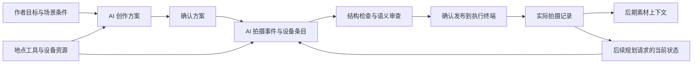
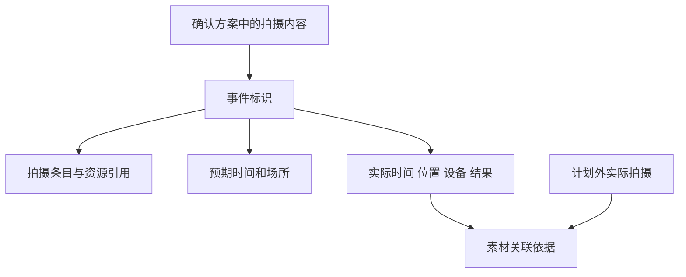

# 一种人工智能驱动的影像创作规划与拍摄协同方法

## 保护中心

Pharos 是以 AI 为规划与协作主体的影像创作系统。作者提供创作目标，系统结合实际拍摄条件，将目标逐层组织成创作方案、拍摄段落、拍摄事件和设备条目，经审查后交给现场执行；现场产生的实际记录继续关联原任务，成为修订方案及后期素材组织的依据。

主案覆盖上述转换关系。目的地、旅行日期、路线地图属于当前实施例；上位对象采用创作项目、拍摄段落、场所、时间窗口、拍摄事件和资源。纪录片与电影适用方式分别写入实施例。

## 说明书摘要

本发明公开一种人工智能驱动的影像创作规划与拍摄协同方法。以创作目标、场景条件和设备资源构成规划上下文，利用语言模型生成可审阅创作方案，再将确认方案分解为具有稳定标识的拍摄事件及其多设备拍摄条目。系统核对方案承诺、事件内容和资源引用的一致性，将通过审查的结构化计划提供给执行终端。终端通过事件标识记录实际时间、位置、设备及执行结果，分别保存计划与实际记录。再次规划时读取当前计划和实际记录，生成后续拍摄调整建议；同时输出可关联媒体素材的实际拍摄上下文，供后期组织使用。

## 权利要求书

1. 一种人工智能驱动的影像创作规划与拍摄协同方法，由计算机系统执行，其特征在于，包括：

获取以自然语言表达的影像创作目标、拍摄场景的时间和空间条件以及具有资源标识的可用拍摄设备，构成创作规划上下文；

将所述创作规划上下文提供给语言模型，由所述语言模型生成包含拍摄段落和拍摄内容要求的创作方案，并接收对所述创作方案的确认；

将确认后的创作方案及可用拍摄设备提供给由语言模型驱动的拍摄规划处理，按拍摄段落生成结构化拍摄计划，所述结构化拍摄计划包括具有稳定事件标识的拍摄事件，各拍摄事件记载拍摄内容、场所及可选时间窗口，并包含引用所述资源标识的一个或多个拍摄条目；

对所述结构化拍摄计划执行结构和资源引用检查，并利用语言模型对确认方案中的拍摄内容要求与拍摄事件之间的对应关系进行语义一致性审查；依据检查和审查结果形成供用户确认的计划版本，将确认后的计划版本提供给拍摄执行终端；

由所述拍摄执行终端通过所述事件标识关联记录实际执行时间、实际位置、实际使用的拍摄设备及执行结果，将该执行记录与计划中的预期安排分别保存；

响应于后续规划请求，将当前计划与执行记录重新提供给所述拍摄规划处理，依据已完成和待执行事件的状态生成后续拍摄调整建议，保留既有事件标识及其实际记录的关联；并输出包含所述事件标识、拍摄内容与实际执行信息的拍摄上下文，以供后期系统关联媒体素材。

2. 根据权利要求1所述的方法，其特征在于，接收尚未确定日期、具体场所或执行条件的创作意图时，分别保存各项信息的已知内容、候选内容及未定状态；在获得推进至拍摄规划的指令后生成带版本的交接快照，由所述语言模型继承已知内容并针对缺失条件继续组织规划。

3. 根据权利要求1所述的方法，其特征在于，所述拍摄规划处理根据共同的场所、时间段及拍摄内容将多个设备条目归入同一拍摄事件，在事件内分别记录拍摄类型、相机及镜头引用；对于连续记录的过程，建立包含起终点、多设备视角和过程内提示点的连续拍摄任务。

4. 根据权利要求1所述的方法，其特征在于，所述拍摄规划处理调用地点查询工具取得坐标，读取资源注册表取得设备标识，并将模型生成的拍摄内容与所述工具和注册表提供的结构化信息组合；检查过程验证坐标表达格式、资源引用及事件标识。

5. 根据权利要求1所述的方法，其特征在于，语义一致性审查核对确认方案所承诺的拍摄内容是否被任务覆盖，以及任务是否引入未确认的核心拍摄要求；对结构化计划生成对应的可读审阅表，保留创作方案与结构化计划之间的文档关联，审查结果不直接改写已确认的创作方案。

6. 根据权利要求1所述的方法，其特征在于，对于尚未明确绝对日期的拍摄事件，将其保存为候选事件；对明确排期或实际完成的事件建立日期归属，排期改变时保持事件标识及实际记录关联，已经执行的历史保留在实际日期。

7. 根据权利要求1所述的方法，其特征在于，执行结果区分按预期完成、偏离预期完成及放弃；对未关联既有拍摄事件的实际拍摄建立计划外记录，后期拍摄上下文同时包含计划内与计划外实际拍摄。

8. 根据权利要求1所述的方法，其特征在于，对经确认的创作研究资料按作品及场所建立独立索引，使执行终端在相应拍摄上下文中展示资料；研究资料与拍摄执行记录分别保存，资料更新不改变执行状态。

9. 根据权利要求1所述的方法，其特征在于，从候选及已排期拍摄条目的设备引用派生器材清单和设备校时事项；输出后期拍摄上下文时保留实际时间、设备信息以及可关联的定位轨迹。

10. 一种人工智能驱动的影像创作规划与拍摄协同系统，包括处理器、存储器、语言模型调用模块及拍摄执行终端接口，其特征在于，所述存储器中的程序被执行时，使系统执行权利要求1至9中任一项所述的方法。

11. 一种计算机可读存储介质，其上存储有程序，其特征在于，所述程序被处理器执行时实现权利要求1至9中任一项所述的方法。

12. 一种计算机程序产品，包括程序，其特征在于，所述程序被处理器执行时实现权利要求1至9中任一项所述的方法。

## 技术领域

本发明涉及语言模型辅助的影像制作、结构化拍摄任务生成以及现场执行数据处理，适用于纪实影像、旅行影像及按场景组织的影视拍摄。

## 背景技术

创作方案通常以自然语言表达，现场执行则需要明确的拍摄对象、机位设备、时间和场所。将创作文本细化成拍摄任务时，可能发生拍摄承诺遗漏、资源名称无法对应实际设备、多个机位被拆成失去共同语境的任务，以及现场变化不能准确传递至后期等问题。

机器生成分镜和镜头清单已存在公开方案。本发明所处理的是生成方案、结构化拍摄任务、现场实际记录和后期素材上下文之间的连续转换，以及转换时语义内容与机器引用的一致性。

## 发明内容

语言模型承担创作目标理解、方案组织、拍摄细化及语义审查。确定性工具提供地点和设备信息，验证任务结构与引用。两者共同把自然语言创作要求转为执行终端可消费的数据。

拍摄事件是连接创作内容与现场执行的基本单位。同一事件可以包含不同设备及拍摄类型，现场记录以事件标识保存实际拍摄事实。上层方案调整、任务排期变化与已发生事实分别表达，使下一轮 AI 规划能够读取当前状态，后期也能依据实际拍摄时间和设备关联素材。

该结构使 AI 生成结果具有可执行的数据落点：从方案进入设备条目和终端任务，再从实际执行进入后期上下文。研究资料通过作品和场所提供现场理解支持，独立于拍摄事实。

## 附图说明

图1为系统总体流程；图2为拍摄事件的数据关联。

## 具体实施方式

### 1. AI 输入与输出

方案阶段输入作者目标、场景条件、资源摘要及明确的未知项，输出可阅读和修改的创作方案。拍摄细化阶段输入确认方案、设备注册表和生成结构，输出事件数组。事件至少包含标识、拍摄内容、地点及设备条目；日期不确定时保存在候选集合。

一种实现采用可调用工具的语言模型智能体：智能体查询地点，将返回的坐标写入场所字段；从设备注册表选择相机和镜头标识；输出 JSON 后调用校验器和审阅表渲染器。语义审查使用确认方案、生成任务及确定性检查结果，输出遗漏、冲突及新增承诺等审查项。确认完成后发布任务。

对于“用广角交代环境，再以长焦呈现被摄主体细节”的要求，可形成一个共同事件，事件内保存两条设备条目。设备不存在或引用失效时，结构检查要求修正；核心拍摄内容缺失时，语义审查指出对应方案要求。

### 2. 拍摄现场与后期交接

执行终端展示拍摄内容、设备与现场资料。用户按实际拍摄情况记录时间、位置和所用设备；同一事件提前、延后或部分偏离预期时，实际记录仍关联原标识。新增拍摄直接形成计划外记录。

再次请求 AI 调整方案时，先取得终端同步后的当前计划与执行记录。智能体据此讨论和生成后续建议，经审查和确认写入计划版本。此处的反馈通过数据回读完成，不依赖在线训练模型。

后期接口输出结构化计划、实际记录及轨迹。素材关联程序使用实际记录判断事件发生情况；计划中的预期安排继续作为创作语境保存。

### 3. 纪录片实施例

以“记录一段生产活动”为创作目标，作者提供可进入的场所、活动时间及设备。AI 组织拍摄段落，并生成环境建立、活动过程和细节等拍摄事件；同一事件可采用主机位与补充机位。现场记录活动实际发生时间、拍摄结果以及临时新增内容。后期依据实际事件记录组织对应素材。

这一例子使用现有创作要求、拍摄事件、设备条目和实际记录机制；题材由旅行转为纪录片活动，无需将路线地图作为必经入口。

### 4. 电影拍摄适用实施例

作者提供已经确定的场景内容与需要完成的镜头目标，将其作为确认方案的拍摄段落。系统据此结合可用摄影设备和场所条件生成拍摄事件及机位条目，现场记录实际完成情况，供后期关联取材。

本实施例表达上述通用机制在按场景拍摄中的适用方式。演员调度、服化道排程、场记板识别和镜头连续性检查属于另行设计的能力，不作为本案已有实现依据。

### 5. 不同成熟度的创作项目

对只有初衷的项目，分别记录主题、场所范围、时间精度和条件缺口；项目可以停留在该粒度。作者决定推进时，生成显式版本快照，将已有信息交给方案阶段。进入终端执行的任务采用另行确认的计划版本，避免早期探索内容直接变成现场任务。

## 撰写依据与检索取舍

- [Pharos 拍摄细化与事件粒度](/Users/dtysky/Projects/dtysky/Pharos/designs/requirements.md:107)
- [AI 规划、分镜编排和现场记录架构](/Users/dtysky/Projects/dtysky/Pharos/designs/overview.md:79)
- [生成处理的输入、设备和候选模式](/Users/dtysky/Projects/dtysky/Pharos/.ai/skills/shot-planner/SKILL.md:25)
- [确定性检查与语义一致性审查](/Users/dtysky/Projects/dtysky/Pharos/.ai/skills/plan-consistency-reviewer/SKILL.md:24)
- [不同成熟度及显式交接](/Users/dtysky/Projects/dtysky/Pharos/designs/atlas.md:5)

当前仓库提供旅拍场景的实施依据，纪录片和电影例子是对同一任务与记录机制的应用展开。主案名称与独立权利要求不绑定旅行。

[US20220237368A1](https://patents.google.com/patent/US20220237368A1/en) 的说明书已涉及从剧本场景产生镜头清单和分镜；[US20260194361A1](https://patents.google.com/patent/US20260194361A1/en) 已公开模型生成及修改行程。本案的撰写重点是创作内容、资源化拍摄事件、生成审查、终端实际记录和后期上下文之间的协同转换。
