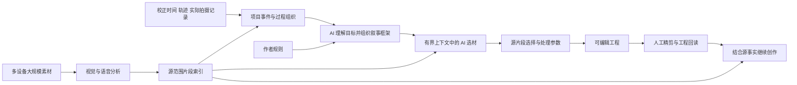
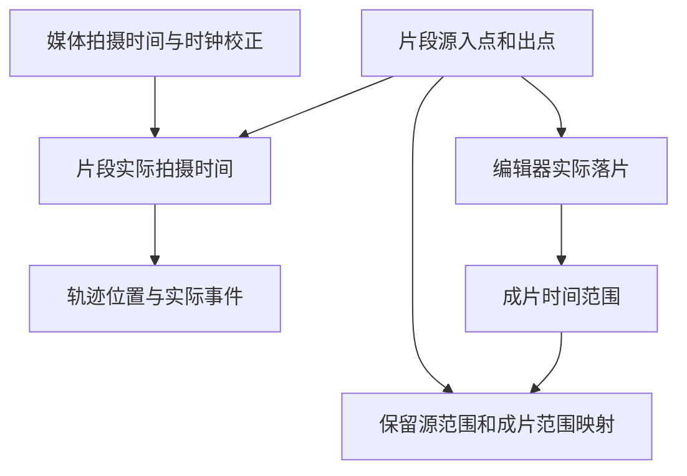

# 一种基于多模态素材与时空事件的智能剪辑方法

## 保护中心

Kairos 是面向大规模真实素材的智能剪辑助手。它理解画面与声音，并结合真实拍摄时间、地理轨迹、拍摄执行记录形成项目事件组织；再依据作者的创作目标和规则，把可引用的素材片段组织成作品，落实到专业剪辑工程，并承接人工编辑后的结果继续创作。

主案保护“素材理解—时空事件—创作编排—实际工程”的转换关系。素材分析、事件构建和具体剪辑分别拥有数据依据，通过稳定片段引用连接；时间与空间信息实际参与事件组织和选材语境。

## 说明书摘要

本发明公开一种基于多模态素材与时空事件的智能剪辑方法。对项目媒体进行视听分析，生成带源媒体范围的候选片段；结合校正后的拍摄时间、定位轨迹及实际拍摄记录，建立引用候选片段的事件、过程与缺口组织。将经确认的事件组织和创作规则提供给语言模型智能体，形成叙事框架，并按框架范围向素材选择处理提供片段事实和步骤约束。系统将所选片段及处理参数转换为可编辑工程，读取实际片段边界以建立源素材与成片的时间对应。人工编辑后，以当前工程回查素材事实并继续处理，实现大规模素材的时空增强理解与人机协同剪辑。

## 权利要求书

1. 一种基于多模态素材与时空事件的智能剪辑方法，由计算机系统执行，其特征在于，包括：

对项目中的多个媒体资产建立资产索引，取得经时间校正处理的拍摄时间及源媒体范围，利用视觉模型和语音识别处理取得视听分析结果，并形成具有片段标识、源媒体标识、源时间范围和视听内容描述的候选片段索引；

根据所述拍摄时间与源时间范围确定候选片段的实际时间范围，按该实际时间范围关联定位轨迹和可用的实际拍摄记录，建立引用候选片段的项目事件组织，所述项目事件组织分别表达拍摄事件、移动过程以及已知拍摄事件与可用素材之间的缺口；

将所述项目事件组织以及创作目标和创作规则提供给语言模型智能体，由所述语言模型智能体形成叙事框架，所述叙事框架包括可对应素材范围的编排段落；

依据所述编排段落构造素材选择上下文，所述素材选择上下文包括相应的候选片段事实、资产时间信息和适用于该步骤的创作约束，由语言模型智能体输出包含所选片段标识及片段处理参数的结构化剪辑选择结果；

根据所述结构化剪辑选择结果回查源媒体及源时间范围，通过编辑器接口建立可编辑时间线，读取编辑器返回的实际片段边界，形成所选源媒体范围与实际时间线范围之间的对应关系；

响应于人工编辑后的继续创作请求，读取当前时间线的片段顺序、源媒体范围及已有字幕，通过当前源媒体引用回查片段事实，将所述当前工程状态和对应片段事实提供给后续智能体处理，以生成与实际编辑结果对应的后续创作产物。

2. 根据权利要求1所述的方法，其特征在于，素材理解包括代表帧粗扫、语音分析及统一视听判断，并对需要进一步识别的素材生成候选时间窗口，对所述候选时间窗口提取细扫帧并生成窗口级视觉描述；所述候选片段保留对应源范围、窗口分析结果和可用的定时语音内容。

3. 根据权利要求1所述的方法，其特征在于，源媒体分析结果、候选片段索引、项目事件组织和作品剪辑结果分别保存；候选片段内容描述从源媒体分析结果生成，项目时空信息用于事件组织和创作上下文，各层通过媒体标识与片段标识关联。

4. 根据权利要求1所述的方法，其特征在于，将不同设备的拍摄时间归一到共同时间基础，记录设备或素材源的时钟校正，并保留原始时间；将归一后的拍摄时间与片段源范围组合，取得用于轨迹关联及事件归属的片段时间范围。

5. 根据权利要求1所述的方法，其特征在于，具有实际拍摄记录时，以已完成事件的实际时间窗口匹配候选片段；存在多个重叠事件窗口时，依据记录中的拍摄类型和设备信息以及窗口范围确定归属；计划中未执行或已放弃的预期时间不作为实际发生事件的直接匹配窗口。

6. 根据权利要求1所述的方法，其特征在于，先根据时间连续性和轨迹关系生成候选事件，再由语言模型智能体提出受相邻关系和事件边界约束的语义归并结果；程序验证输入版本、片段覆盖及顺序后写入待审事件组织，保持源媒体时间、位置与片段事实。

7. 根据权利要求1所述的方法，其特征在于，针对大规模素材，将资产分析与创作推理分阶段执行，保存可复用的资产报告和片段索引；依据确认的执行计划按连续日期、事件数量或素材引用数量构造有界任务分片，各分片接收相应步骤约束及所需片段事实，合并结果保留所选片段标识和框架段落归属。

8. 根据权利要求1所述的方法，其特征在于，语言模型智能体根据自然语言创作规则、可用能力及输入状态生成执行计划，计划步骤记载能力标识、输入输出引用、步骤约束和审查条件；保存规则版本，执行时核对版本与声明输入，并使所述素材选择上下文包含当前步骤约束。

9. 根据权利要求1所述的方法，其特征在于，所述结构化剪辑选择结果分别保存片段选择与声音或速度处理参数，对原声保留、未选口播覆盖及源范围进行核对；编辑器实际落片边界用于生成与保留原声对应的字幕时间。

10. 根据权利要求1所述的方法，其特征在于，多个作品共用资产索引、候选片段索引和项目事件组织，分别采用创作规则、叙事框架及剪辑选择结果；对人工精剪后的工程生成旁白或字幕时，依据当前源映射、已有原声覆盖和片段实际时长组织生成上下文。

11. 一种智能剪辑系统，包括处理器、存储器、视听分析模块、语言模型智能体接口和编辑器接口，其特征在于，所述存储器中的程序被执行时，使系统执行权利要求1至10中任一项所述的方法。

12. 一种计算机可读存储介质，其上存储有程序，其特征在于，所述程序被处理器执行时实现权利要求1至10中任一项所述的方法。

13. 一种计算机程序产品，包括程序，其特征在于，所述程序被处理器执行时实现权利要求1至10中任一项所述的方法。

## 技术领域

本发明涉及多模态媒体理解、时空数据关联、语言模型辅助媒体编排及非线性编辑，适用于跨设备、多批次和长周期拍摄项目的素材组织与剪辑。

## 背景技术

大规模拍摄项目包含大量短片、长记录、原声、航拍、延时及照片。单个素材的视听内容只能表达局部观察；素材文件顺序、拍摄计划顺序和实际事件顺序也可能不同。仅凭画面描述或文件日期进行选材，难以完整恢复项目内的事件和过程。

同时，将全部原始媒体和详细分析一次性提供给创作模型会扩大处理量与上下文规模；从模型生成文本到编辑器真实片段还存在源范围和时间量化差异。本发明以可复用片段索引、独立时空事件层、分阶段创作上下文和实际工程回读共同处理这些问题。

## 发明内容

本发明首先形成具有源范围的素材内容单元，再利用项目时空依据组织事件。视觉与语音分析保留素材可观察内容，拍摄时间、轨迹及实际记录用于确定事件关系。语言模型在这一项目组织上理解作者目标、生成框架，并在受约束的片段集合中作出剪辑选择。

大规模处理采用分层持久化和有界任务上下文：原始媒体经过分析后形成可复用报告；片段索引供多次创作引用；宏观框架与局部素材选择分阶段完成。各阶段通过明确片段标识保留取源依据，剪辑器执行后再建立实际成片时间对应。

由此，AI 的内容理解、项目时空信息和作者规则共同参与成片组织。项目事实可由多部作品复用，人工编辑后的工程能够重新成为后续处理输入。

## 附图说明

图1为整体数据流；图2为媒体源时间、实际拍摄时间和成片时间的对应。

## 具体实施方式

### 1. 大规模素材理解

为每一媒体保存资产标识、源路径、时长、帧率及拍摄时间。视觉阶段从代表帧取得内容观察，语音阶段生成转写及对齐时间；统一判断阶段选择需要细扫的窗口。窗口细扫取得对应画面事实并保留源范围。

报告按资产独立保存。片段构建阶段读取资产与报告，形成包含源入出点、视觉观察和可用语音内容的索引，再用语言模型生成可供创作消费的简短内容模式。报告、片段索引和事件层分别刷新，后续作品不必重新读取全部原始媒体。

### 2. 时空增强与实际事件

设资产经校正的拍摄起始时间为 T，片段在源媒体中的范围为 [a,b]，则其实际时间范围为 [T+a,T+b]。按实际时间查询轨迹，取得位置或空间过程；读取现场记录的实际拍摄窗口及显式设备信息，建立事件归属。

对于未直接匹配实际事件的片段，根据时间与空间连续性组织候选事件和移动过程。AI 在允许的相邻事件间进行语义归并；程序核对片段序列及覆盖，避免归并时改变原始时间、位置或遗漏素材。已知发生而未找到对应素材的拍摄事件形成待审缺口。

这一层保留事实顺序。作品可以采用不同叙事顺序，其编排结果另行保存。

### 3. 从事件理解到选材

智能体接收确认后的事件组织、作者目标和剪辑规则，生成全片章节及可执行的分段框架。素材选择阶段接收框架、相应候选片段与资产索引以及当前步骤约束，输出每段选择的片段标识和稀疏处理参数。

时空信息在事件组织和框架中形成创作语境；具体选材阶段按声明输入读取素材事实，并使用校正后的拍摄时间计算片段时间。不同阶段不需要重复接收全部轨迹、报告和原始媒体。

对于长周期项目，可按连续日期或输入数量划分任务包，由智能体分别处理；任务包保留段落身份、步骤约束和候选片段引用，合并后核对所选标识、取源范围和规则要求的覆盖情况。

### 4. 工程执行与人工接管

时间线生成处理将已选片段的源范围发送至专业编辑器，读取实际开始与结束帧，生成源素材到成片位置的映射。原声字幕按照该实际映射输出。

作者精剪后，再次读取当前片段顺序、源范围和字幕。若片段名称仍包含旧标识而源媒体已替换，优先依据当前源媒体确定素材事实。后续旁白、字幕或片头编排在当前工程上继续进行。

### 5. 使用情境

某纪录片项目跨多个日期、地点和设备拍摄。作者希望将分散素材组织成若干主题段落。系统先分析素材内容，再依据实际时间与轨迹还原项目事件；模型据此组织框架，在各段落候选中选择相应画面与原声，并生成可编辑时间线。作者调整顺序和取源范围后，系统读取新工程继续处理。

若同一批素材还需要制作短片，复用项目事实层，另行采用作品规则与框架；不因第二部作品的叙事选择改写项目原始事件事实。

## 已有规模与实现依据

2026-10-30 对本地项目索引的只读统计：

| 项目索引 | 媒体资产数 | 候选片段数 | 有正数 durationMs 的资产时长合计 |
|---|---:|---:|---:|
| bingchacha-genie-south-zimeiyakou | 2,253 | 6,626 | 20.74 小时 |
| min-gan-midautumn-national-day | 2,142 | 2,413 | 8.55 小时 |
| new-zealand-documentary | 3,439 | 本次未发现 spans 文件 | 27.60 小时 |

以上是已有数据规模统计，处理耗时、峰值资源和最终成片质量另按运行记录衡量。计算口径为 assets 数组、spans 数组及资产中的正数 durationMs 之和。

- [大规模素材项目资产索引](/Users/dtysky/Projects/dtysky/Kairos/projects/bingchacha-genie-south-zimeiyakou/store/assets.json)
- [对应片段索引](/Users/dtysky/Projects/dtysky/Kairos/projects/bingchacha-genie-south-zimeiyakou/store/spans.json)
- [素材、事件、事实层及语义归并](/Users/dtysky/Projects/dtysky/Kairos/designs/current-solution-summary.md:278)
- [实际拍摄时间与轨迹的使用](/Users/dtysky/Projects/dtysky/Kairos/designs/current-solution-summary.md:363)
- [阶段分析与细扫实现](/Users/dtysky/Projects/dtysky/Kairos/src/modules/media/project-analyze.ts:399)
- [事件语义归并及片段序列校验](/Users/dtysky/Projects/dtysky/Kairos/src/modules/media/chronology-event-consolidation.ts:86)
- [创作规则、任务上下文及有界分片](/Users/dtysky/Projects/dtysky/Kairos/designs/current-solution-summary.md:479)
- [框架与素材选择的输入输出](/Users/dtysky/Projects/dtysky/Kairos/.ai/skills/kairos-edit-flow/SKILL.md:68)

## 检索取舍

当前主案把项目外部的拍摄时空依据与素材内视听理解相结合，再通过明确片段引用进入创作和工程。此处“空间”包括真实拍摄位置和轨迹，与视频模型内部的帧间空间特征分别说明。

[WO2026089657A1](https://patents.google.com/patent/WO2026089657A1/en) 涉及长视频的多阶段、多模态及帧间时空理解；[EP3338058B1](https://patents.google.com/patent/EP3338058B1/en) 涉及基于位置的视频呈现、选择和同步。主案比较需覆盖这些能力，重点核对多源实际拍摄事实、事件组织、有界创作输入和工程源范围的组合关系。

[Premiere AI Assistant 官方说明](https://helpx.adobe.com/premiere/desktop/premiere-ai-assistant/assistant-faq.html) 已介绍对话式多步骤编辑和初剪。一般的“AI 调用剪辑工具”不承担本案的全部区别；主案应完整呈现上述素材理解与时空增强组织。
